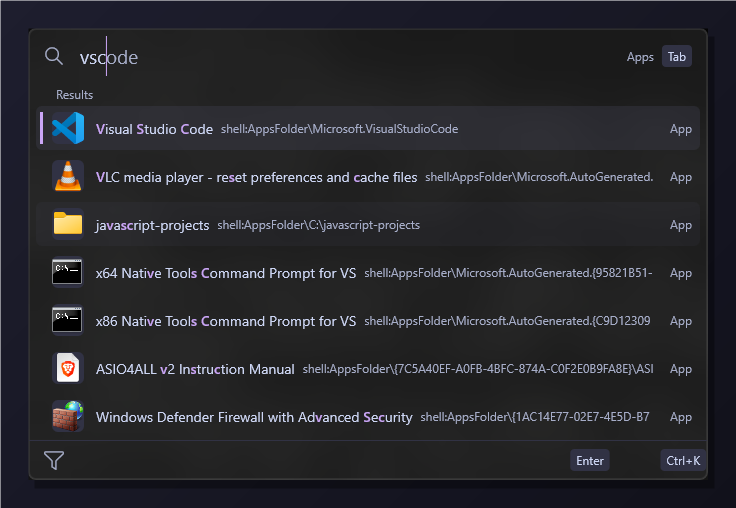

# tapir

[](https://github.com/hamzahraihan/tapir/releases/latest)


Press `Ctrl+Space`. Find an app or paste from clipboard history. tapir is a Spotlight-style launcher for Windows 10 and 11 with exactly two features: fuzzy app search and searchable clipboard history. It ships as one executable, with an optional installer, no network access, and no telemetry.

<p align="center">
  
</p>

## Why tapir

- **Instant.** The popup appears on the hotkey and results update on every keystroke with no debounce. Nothing runs at idle.
- **Native.** Win32, Direct3D 11, Direct2D, DirectWrite, and DirectComposition. No Electron, WebView, Qt, or WinUI.
- **Private.** Clipboard history stays local and is encrypted at rest with DPAPI. The app has no network code.
- **Small.** One statically linked executable under 1 MB. The installer is optional.
- **Keyboard-first.** Every action has a key. The mouse is an alternative, not a requirement.

## Get started

### Install

Download the [latest release](https://github.com/hamzahraihan/tapir/releases/latest) and run `tapir-setup.exe`. The installer puts `tapir.exe` in `%LOCALAPPDATA%\Programs\tapir`, adds a Start menu shortcut, and offers an optional desktop shortcut. It never asks for administrator rights.

You can also download `tapir.exe` from the same release and run it from any folder. Uninstalling removes the executable and shortcuts but keeps the config directory, so settings and history survive a reinstall. To remove tapir completely, close it and delete the executable and its config directory.

### First launch

The popup starts hidden. Press `Ctrl+Space` to show it and press `Ctrl+Space` again to hide it. Clicking away or losing focus also hides it. If another app uses the hotkey, tapir shows a message once. Change `general.hotkey` in the config file and start tapir again.

Startup is off by default. To turn it on, set `start_with_windows = true` in `[general]`. tapir then writes an HKCU `Run` value named `tapir` that points at the executable. Setting the key back to `false` removes the value.

## Two features

**Apps** - Type to filter apps from the shell AppsFolder and Start Menu shortcuts. Matching characters are highlighted, frequently launched apps float up, and `Enter` launches the selection. Icons load only for visible rows.

**Clipboard** - Press `Tab` to switch modes. tapir keeps text-only clipboard history, deduplicates consecutive copies, and protects sensitive copies. `Enter` pastes the selected entry into the window you came from. `Shift+Enter` copies it without pasting.

Switching modes clears the query. In compact mode the list stays hidden until you type, then expands. Clipboard mode shows the list right away.

### Keyboard

| Key | Action |
|---|---|
| `Ctrl+Space` | Show or hide the popup |
| Type | Filter results |
| `Up`, `Down` | Move the selection one row |
| `PageUp`, `PageDown` | Move the selection one page |
| `Enter` | Launch the selected app, or paste the selected clipboard entry |
| `Shift+Enter` | In Clipboard, copy the entry without pasting. In Apps, does nothing |
| `Ctrl+K` | Open or close the More actions menu for the selected item |
| `Ctrl+P` | Pin or unpin the selected clipboard entry. Apps ignores this key |
| `Delete` | Remove the selected clipboard entry. In Apps, delete forward in the text field |
| `Ctrl+Shift+Delete` | Clear all unpinned clipboard entries |
| `Esc` | Close the More menu, then clear the query, then hide the popup |
| `Home`, `End` | Move the text caret |
| `Ctrl+Left`, `Ctrl+Right` | Move the caret one word |
| `Ctrl+A`, `Ctrl+C`, `Ctrl+X`, `Ctrl+V` | Select all, copy, cut, and paste in the text field |
| Focus loss | Hide the popup |

You can also hover a row, click it to activate it, and use the wheel to scroll.

### More actions

Press `Ctrl+K` to open a filterable menu for the selected item.

- Apps: Open, Run as administrator, Open file location, Copy path.
- Clipboard: Paste, Copy only, Pin or Unpin, Delete.

Set `details_pane = true` in `[window]` to show a pane beside the list in Clipboard mode. The pane shows the full raw text of the selected entry, wraps long lines, and scrolls with the wheel when the pointer is over the pane. It is off by default.

## Configure

tapir reads `%USERPROFILE%\.config\tapir\config.toml`. On first run it creates the directory and a commented default file. It never overwrites an existing config on startup. Set `TAPIR_CONFIG_DIR` to use a different directory.

The tray icon opens a Settings window. Every key can be edited there, and changes are written to `config.toml` when you press OK. The writer patches values in place, so comments and unknown keys survive. The tray menu toggles animations, restarts tapir, and quits it. Left-clicking the tray icon shows or hides the popup.

tapir watches the config directory and applies changes 300 ms after a change. Invalid TOML leaves the last good config in place and writes an error to the log. Missing keys use defaults. Unknown keys produce a warning in the log.

The default file is also the reference for every key and default:

<details>
<summary>Default config.toml</summary>

```toml
	[general]
	version = 1
	hotkey = "Ctrl+Space"
	animations = true
	start_with_windows = false

	[window]
	monitor = "cursor"
	position = "upper-center"
	width = 680
	compact = true
	max_visible_rows = 8
	details_pane = false

	[theme]
	backdrop = "acrylic"
	backdrop_opacity = 0.95
	font = "Segoe UI Variable"
	preset = "catppuccin"
	mode = "dark"
	background = "#2b2b2b"
	foreground = "#cdd6f4"
	accent = "#cba6f7"
	muted = "#6c7086"
	surface = "#313244"
	selection = "#cba6f7"

	[history]
	max_entries = 500
	max_entry_bytes = 1048576
	ignore_processes = []

	[index]
	sources = ["appsfolder", "startmenu"]

	[privacy]
	encrypt_history = true
```

</details>

A few keys take a fixed set of values:

- `general.hotkey` takes one key from `A` to `Z`, `0` to `9`, `F1` to `F12`, or `space`, with at least one modifier from `Ctrl`, `Alt`, `Shift`, and `Win`. Join the parts with `+`, for example `Ctrl+Alt+F12`.
- `window.monitor` takes `cursor`, `active`, `primary`, or a 1-based monitor index.
- `window.position` takes `upper-center` or `center`.
- `theme.backdrop` takes `acrylic`, `mica`, or `none`.
- `theme.backdrop_opacity` takes a number from `0.0` to `1.0`. Values below `0.6` keep a minimum frosted-glass tint instead of washing out to a flat light surface.
- `history.max_entry_bytes` is in bytes. `1048576` is 1 MB.
- `index.sources` takes `appsfolder`, `startmenu`, or both.

`theme.preset` takes `nord`, `catppuccin`, `kanagawa`, `material`, or `gruvbox`, and `theme.mode` takes `dark` or `light`. Explicit color keys override the preset, so an existing config with hand-edited colors keeps its appearance.

## Privacy

tapir captures text only, through `CF_UNICODETEXT`. It skips a copy that sets `ExcludeClipboardContentFromMonitorProcessing`. It also skips a copy that sets `CanIncludeInClipboardHistory` unless that format holds a `DWORD` equal to `1`. A present but unreadable value blocks capture; an absent format does not by itself block it. `CanUploadToCloudClipboard` is ignored. `history.ignore_processes` matches the executable file name of the app that owns the clipboard at capture time.

History is protected with DPAPI by default. tapir writes `history.dat` to a temporary file and replaces it atomically, with writes debounced. A corrupt file is backed up and the app starts with fresh history. The log records reasons only and never contains clipboard text.

All app data lives in the config directory: `config.toml`, `history.dat`, `tapir.log`, `launches.dat`, and `index.cache`. `launches.dat` holds app keys and launch counts. `index.cache` is a local snapshot of the app list so results are available on the first keystroke; the list is rebuilt in the background and the cache is replaced then. A missing or corrupt cache is ignored. The startup `Run` value is opt in. For the evidence behind these claims, see [the privacy audit](docs/privacy-audit.md).

## Build from source

You need Visual Studio Build Tools with the C++ workload, CMake 3.24 or newer, and MSVC. tapir uses C++20 and a static CRT.

	cmake -S . -B build
	cmake --build build --config Release

The Release configuration enables link-time code generation and writes a separate PDB. The executable is written to `build\Release\tapir.exe`. Measured numbers are in [the budget report](docs/budget-report.md). To repeat them, run `tools/measure.ps1` from PowerShell 7 on Windows after a Release build. The harness uses local performance counters and screen capture only.

Build and run the tests with:

	cmake --build build --config Debug --target tapir_tests
	build\Debug\tapir_tests.exe

To build the optional installer, install Inno Setup 6 and run `ISCC.exe installer\tapir.iss`. The setup executable is written to `installer\Output\tapir-setup.exe`.

## Release

Push a tag such as `v0.1.0`, or run the `CI and Release` workflow manually with an existing tag. The workflow builds Release, runs the tests, compiles the installer, and publishes `tapir-setup.exe` and `tapir.exe` on the GitHub release. The tag without the leading `v` becomes the installer version.

## Manual checks

Two areas still need a person at a real desktop: mixed-DPI behavior across monitors with different scaling, and the solid fallback on Windows 10 and in high-contrast mode. Automated tests do not cover either.

- [ ] Mixed-DPI behavior across monitors with different scaling
- [ ] Solid fallback on Windows 10 and in high-contrast mode
- [ ] Tray icon, Settings tabs, hotkey recording, and config reload
- [ ] History encryption toggle and restart
- [ ] Restart and Quit from the tray menu

<details>
<summary>Tray and settings checklist</summary>

1. Press the hotkey to show the popup, then left-click the tray icon to hide it; left-click again to show it.
2. Right-click the tray icon. The menu has four items in order: Show/Hide animation, Settings, Restart, Quit. Toggle the animation item, confirm its checkmark follows, then edit `general.animations` in `config.toml` by hand and confirm the checkmark follows the reload.
3. Open Settings from the tray. Check all five tabs, edit a value and a hotkey with Record, press Cancel and confirm nothing changed, then press OK and confirm the value persists after a restart. Check that comments and unknown keys remain in `config.toml`.
4. Flip `privacy.encrypt_history` in Settings with an existing `history.dat`, confirm `history.dat.bak` appears and history still works after restart.
5. Choose Restart from the tray menu and confirm the popup and tray icon come back. Choose Quit and confirm the process exits and the tray icon disappears.

</details>
